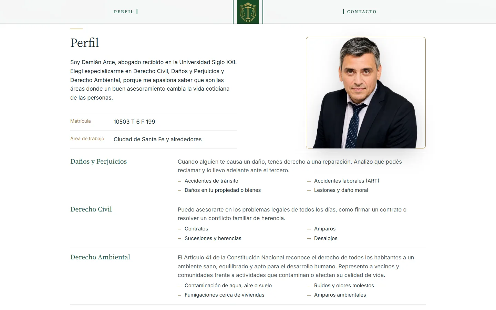

# Damián Arce · Abogado

Sitio web profesional para un abogado de Santa Fe, Argentina. Es una landing de una sola página pensada para un objetivo concreto: que la persona que llega con un problema legal termine escribiendo por WhatsApp, con la consulta ya redactada.

**🔗 En vivo: [www.damianarceabogado.com.ar](https://www.damianarceabogado.com.ar)**

<p align="center">
  
</p>

<p align="center">
  
  &nbsp;
  
</p>

## Qué resuelve

La mayoría de las personas que buscan un abogado no saben cómo plantear su consulta. En lugar de un formulario genérico, el inicio muestra **preguntas reales por área de práctica** (Derecho Civil, Daños y Perjuicios, Derecho Ambiental). Al tocar una, se abre WhatsApp con el mensaje escrito:

> Hola Damián, quería hacerte una consulta sobre Daños y Perjuicios: ¿Me chocaron, cómo puedo reclamar?

El abogado recibe la consulta ya clasificada, y el cliente solo tiene que tocar *Enviar*.

## Funcionalidades

- **Carrusel sincronizado:** cada imagen de fondo corresponde a un área de práctica. El título, las preguntas y una barra de progreso cambian junto con la imagen. Si la persona toca una consulta, el carrusel se detiene para que al volver encuentre la misma área.
- **Formulario sin backend:** el formulario de contacto valida los campos y arma un mensaje de WhatsApp con nombre, tema y teléfono. No hace falta servidor, base de datos ni protección contra spam.
- **Las preguntas funcionan sin JavaScript:** los enlaces del HTML ya apuntan al chat de WhatsApp. El JavaScript solo agrega el mensaje prearmado.
- **Diseño adaptable:** se ajustó a mano en cuatro anchos, hasta el iPhone SE (375 × 667). En celular, Perfil y Contacto están compactados para que, al tocarlos en el menú, lo esencial entre en una sola pantalla.

## Detalles técnicos

| | |
|---|---|
| **Stack** | HTML, CSS y JavaScript sin frameworks, sin dependencias y sin paso de build |
| **Peso** | ~830 KB en total, con las imágenes en WebP (el retrato pasó de 540 KB a 40 KB) |
| **SEO** | Datos estructurados `schema.org/Attorney` para búsquedas locales, Open Graph para la vista previa en WhatsApp y redes, `sitemap.xml` y URL canónica |
| **Accesibilidad** | HTML validado por el W3C sin errores, foco visible en teclado, textos alternativos, `aria-label` en los grupos de preguntas y respeto de `prefers-reduced-motion` |
| **Hosting** | GitHub Pages con dominio `.com.ar` propio, DNS en Cloudflare y HTTPS obligatorio |

Algunas decisiones:

- **Sin framework.** Es una sola página con contenido fijo; React o un generador de sitios agregarían peso y mantenimiento sin aportar nada. El JavaScript completo tiene menos de 140 líneas.
- **WhatsApp en lugar de correo.** Es el canal que usan los clientes del estudio, responde más rápido y evita mantener un servidor para el formulario.
- **Barra de navegación alineada con el contenido.** En escritorio, "Perfil" queda centrado sobre el nombre y "Contacto" sobre el bloque de consultas. Como el ancho de esos bloques depende de la tipografía, la posición se calcula con JavaScript después de que cargan las fuentes y se recalcula al cambiar el tamaño de la ventana.

## Estructura

```
├── index.html        Página única: inicio, perfil, áreas de práctica y contacto
├── css/styles.css    Estilos, con variables de color y tipografía en :root
├── js/main.js        Carrusel, enlaces de WhatsApp y formulario
├── assets/img/       Fotos (WebP), logo y favicon
├── docs/             Capturas para este README
├── CNAME             Dominio propio para GitHub Pages
├── robots.txt
└── sitemap.xml
```

## Correr localmente

No requiere instalación. Se puede abrir `index.html` directamente en el navegador o levantar un servidor estático:

```bash
npx serve .
```

## Autoría

Diseño y desarrollo: **[Quantum Dev](https://www.instagram.com/developerquantum/)**.

El nombre, las fotos, el logo y los textos pertenecen a Damián Arce y no pueden reutilizarse. El código está publicado como muestra de trabajo.
